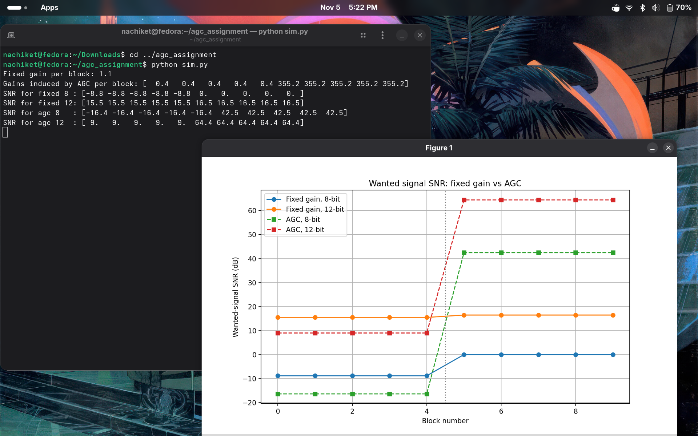

# AGC vs Fixed Gain ADC Simulation

A Python simulation of a receiver front end where a **strong interferer** and a **very weak wanted signal** hit an ADC together. It compares two ways of setting gain before the ADC (fixed gain and block-wise AGC) at 8-bit and 12-bit resolution, and measures how usable the wanted signal is using SNR.

Built as a take-home assignment for an SDR company, and cleaned up as a standalone project.

## The problem

An ADC has a fixed input range and a fixed number of levels. If a strong interferer shares the input with a weak wanted signal:

- The gain must stay **low** so the interferer's peak does not clip.
- At that low gain, the wanted signal becomes smaller than the ADC's **quantization step** and gets rounded away or buried in quantization noise.

So the interferer does not just add noise. It forces a gain setting that destroys the signal you actually care about.

## Setup

| Parameter | Value |
|---|---|
| Sample rate | 1 MHz |
| Capture length | 10 ms (10,000 samples) |
| Wanted signal | 50 kHz sine, amplitude 0.001 |
| Interferer | 200 kHz sine, amplitude 0.9, switches **off** at 5 ms |
| ADC full scale | +/- 1.0 |
| ADC resolutions | 8-bit and 12-bit |
| Block size (for AGC and per-block SNR) | 1000 samples (1 ms), 10 blocks |

**Fixed gain:** one gain value, chosen once so the combined signal's peak sits at 95% of full scale.

**Block-wise AGC:** a new gain for every block, `gain = sqrt(target_power / block_power)`, aiming for a target level of -12 dBFS (based on the receive gain guidance in the [PySDR Pluto chapter](https://pysdr.org/content/pluto.html)).

**SNR:** wanted signal power (after gain) divided by quantization noise power (quantized output minus the ideal pre-ADC signal), in dB.

## Results



Wanted signal SNR in dB (blocks 0 to 4 have the interferer on, blocks 5 to 9 have it off):

| Method | Interferer ON | Interferer OFF |
|---|---|---|
| Fixed gain, 8-bit | -8.8 | 0.0 |
| Fixed gain, 12-bit | 15.5 | 16.5 |
| AGC, 8-bit | -16.4 | 42.5 |
| AGC, 12-bit | 9.0 | 64.4 |

Gain applied: fixed gain stays at about 1.1 throughout. AGC gain is about 0.4 while the interferer is on and jumps to about 355 when it switches off.

## What the results show

1. **Fixed 8-bit reads exactly 0 dB with the interferer off.** The gain was sized for the interferer, so the wanted signal after gain is smaller than half a quantization step and rounds to exactly zero. It is erased, not just degraded.
2. **AGC is worse than fixed gain while the interferer is present** (-16.4 dB vs -8.8 dB at 8-bit). The interferer dominates the block's average power, so AGC pushes the gain even lower than the fixed setting.
3. **AGC wins big once the interferer is gone.** Its gain jumps by roughly 900x, matching the 0.9 to 0.001 amplitude ratio, and the wanted signal finally uses the ADC's range (42.5 dB at 8-bit, 64.4 dB at 12-bit).
4. **More bits help.** Going from 8 to 12 bits shrinks the step by 16x, which is roughly 24 dB (about 6 dB per bit).

## Why AGC should be off for before/after comparisons

With AGC on, the gain is unknown and keeps changing, so you cannot tell whether an output change came from the input or from the AGC reacting. This causes **false attribution**: a real change can be hidden by AGC compensating for it, or a fake change can appear when nothing in the input changed. A fixed, known gain lets you map the output back to the real input.

## Run it

```bash
git clone https://github.com/nachiketttt/agc_vs_fixedgain.git
cd agc_vs_fixedgain
python -m venv venv && source venv/bin/activate
pip install -r requirements.txt
python sim.py
```

Requires Python 3 with `numpy` and `matplotlib`.

## Code structure

| Function | Purpose |
|---|---|
| `generate_signals` | Builds the wanted signal, the gated interferer, and their sum |
| `quantize` | Clips to full scale and rounds to the nearest of 2^bits levels |
| `apply_fixed_gain` | One gain sized to the combined signal's peak |
| `apply_agc` | Per-block gain from block power and a target power |
| `compute_snr` | SNR in dB from signal and quantization noise power |
| `block_snrs` | SNR for each block, used for the plot |

## Limitations and next steps

- Ideal ADC and single-tone signals, with no thermal noise floor or analog filtering.
- The AGC reacts instantly per block, with no attack/release time like real hardware.
- Next: add a noise floor, a filter before the ADC to reduce the interferer, AGC attack/release, and a sweep of interferer amplitude to see where each method breaks down.
